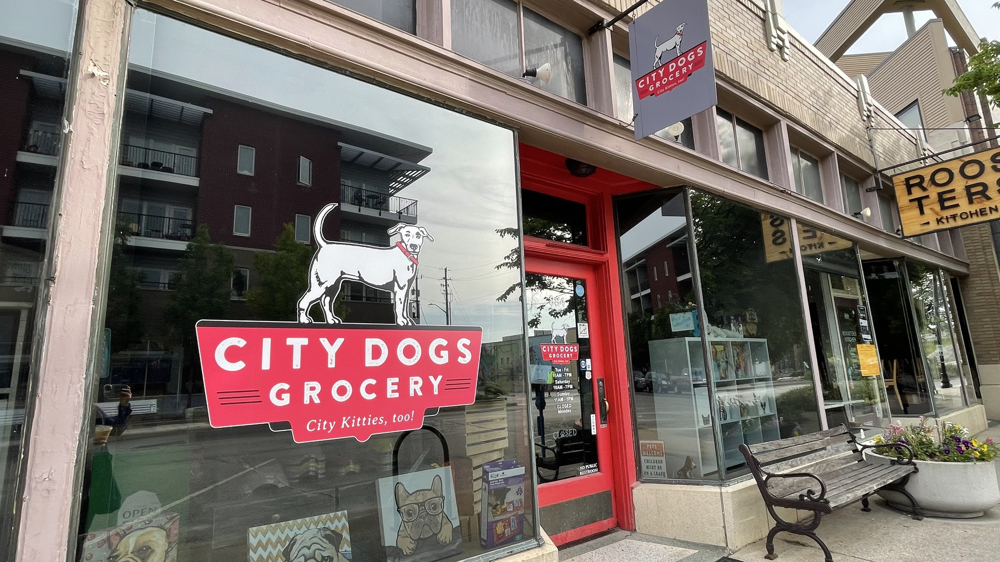

# 🐾 PawPetShop – Premium Java OOP Pet Shop Management System

[](https://openjdk.org/)
[](https://netbeans.apache.org/)
[](https://www.mysql.com/)
[](https://maven.apache.org/)
[](https://www.formdev.com/flatlaf/)
[](https://junit.org/junit5/)

<p align="center">
  
</p>

**PawPetShop** is a production-grade desktop Pet Shop Management System engineered with **Java Object-Oriented Programming (OOP) Architecture**, **Java Swing & Apache NetBeans GUI Builder (Matisse)**, **MySQL via JDBC**, **FlatLaf**, and **OpenPDF**.

Designed specifically for boutique pet supply retailers, PawPetShop delivers a modern desktop experience featuring curated pet photography backgrounds for every screen, warm cream and deep teal brand aesthetics, transactional Point-of-Sale (POS) billing with ACID stock deduction, printable/exportable receipts, live business analytics, and strict role-based access control.

---

## 📸 Application Visual Showcase

### Manager Command Center & POS Billing Terminal
| Screen | Photography Background Preview |
|---|---|
| **Manager Dashboard**<br>Live KPIs, Low Stock Alerts, Inventory Browser |  |
| **Retail POS Billing Terminal**<br>Interactive Cart, Tax Calc, Real-time Stock |  |
| **Authentication Gateway**<br>BCrypt Hashing, Role Detection |  |
| **Add New Pet Supplies**<br>Translucent Card, Category Selector, Validation |  |

---

## 🌟 Key Features & Capabilities

### 🔐 Authentication & Role-Based Authorization
- **BCrypt Password Hashing**: Passwords stored using 12 salt rounds with zero plaintext persistence.
- **Automatic Role Detection**: Directly verifies permissions (`MANAGER` or `CASHIER`) from the database, preventing unauthorized role escalation.
- **First-Run Store Setup**: Automatically prompts and guides first-time store manager creation if the database is uninitialized.

### 👔 Manager Role Capabilities
- **Executive Dashboard**: Real-time KPI summary (Total Products, Low Stock Alerts, Gross Revenue, Active Cashier Staff).
- **Interactive Inventory Management**: Add, update, search, and view catalog with category filtering and dynamic stock adjustments.
- **Safe Soft-Deactivation**: Prevents orphaned database foreign keys by soft-deactivating products that have historical sales while permitting clean deletions for unreferenced items.
- **Cashier Staff Provisioning**: Register, edit, and deactivate cashier accounts with phone and email validation.
- **Financial Analytics & Sales Ledger**: Search transactions by date or payment method (`CASH`, `CREDIT_CARD`, `DEBIT_CARD`, `MOBILE_PAY`), view gross volume, and reprint receipts.

### 🛒 Cashier Role Capabilities
- **Cashier Hub**: Quick-launch POS interface and shift summary.
- **Point of Sale (POS) Billing**:
  - Live product search with automatic category tab sorting.
  - Interactive shopping cart with dynamic `+` / `-` quantity adjustments.
  - Real-time stock availability guard preventing negative stock or overselling.
  - Automated subtotal, discount, 8% sales tax, and cash-change calculation.
- **Transactional Checkout (ACID)**: Multi-table database transaction with rollback guarantees and atomic stock reduction (`UPDATE products SET quantity = quantity - ? WHERE id = ? AND quantity >= ?`).
- **Monospace Receipt Generation**: Clean printable receipt preview with instant hardware print spooling and PDF export powered by **OpenPDF**.

---

## 📐 OOP Architecture & Package Structure

PawPetShop follows a robust three-tier Object-Oriented architecture strictly separating presentation, business logic, data access, and domain models:

```
src/main/java/
├── com.pawmart/
│   ├── Main.java                          # Application Entry Point & Look-and-Feel Setup
│   ├── model/                             # Domain Entities (Encapsulation)
│   │   ├── User.java                      # Manager / Cashier account entity
│   │   ├── Role.java                      # Role enumeration (MANAGER, CASHIER)
│   │   ├── Category.java                  # Pet supply category entity
│   │   ├── Product.java                   # Inventory item entity
│   │   ├── Sale.java                      # Transaction sales record
│   │   ├── SaleItem.java                  # Individual receipt line item
│   │   ├── CartItem.java                  # Active POS cart item
│   │   └── DashboardStats.java            # KPI & analytics encapsulation
│   ├── database/                          # Database Connectivity Layer
│   │   ├── DatabaseConfig.java            # Config loader (env vars, properties, WAMP defaults)
│   │   ├── DatabaseConnection.java        # Thread-safe JDBC connection provider
│   │   └── DatabaseInitializer.java       # Schema verification & seed loader
│   ├── dao/                               # Data Access Object (DAO) Layer
│   │   ├── UserDAO.java                   # User & Cashier SQL queries
│   │   ├── CategoryDAO.java               # Category SQL operations
│   │   ├── ProductDAO.java                # Product catalog & stock queries
│   │   └── SaleDAO.java                   # Transactional checkout & sales ledger
│   ├── service/                           # Business Logic & Validation Layer
│   │   ├── AuthService.java               # BCrypt authentication & session tracking
│   │   ├── UserService.java               # Cashier provisioning & input validation
│   │   ├── ProductService.java            # Inventory business rules & constraints
│   │   ├── CategoryService.java           # Category business rules
│   │   ├── CheckoutService.java           # POS checkout, discount math & transactions
│   │   ├── ReportService.java             # Dashboard metrics & analytics aggregation
│   │   └── ReceiptService.java            # OpenPDF document export & print spooling
│   └── ui/                                # Presentation Layer (Swing & NetBeans Forms)
│       ├── theme/
│       │   └── PawMartTheme.java          # Design system tokens, styling & image scaling
│       ├── components/                    # Reusable Custom Swing Components
│       │   ├── RoundedPanel.java          # Anti-aliased rounded cards with drop shadows
│       │   ├── PrimaryButton.java         # Emerald green action button with hover
│       │   ├── SecondaryButton.java       # Outlined modern button
│       │   ├── DangerButton.java          # Soft crimson deletion/deactivation button
│       │   ├── ModernTextField.java       # Rounded text input with focus highlight
│       │   ├── ModernPasswordField.java   # Password field with show/hide toggle
│       │   ├── ModernTable.java           # Styled JTable with zebra rows & teal header
│       │   ├── StatCard.java              # Dashboard metric card with badge
│       │   └── PawIconRenderer.java       # Procedural vector pet graphics & icons
│       └── views/                         # Modular Dialogs
│           ├── ReceiptPreviewDialog.java  # Modal receipt preview, print & PDF export
│           └── ManagerSetupDialog.java    # First-run manager creation dialog
│
├── [Root Package NetBeans Matisse GUI Forms]
│   ├── login.java / login.form                         # Login & Authentication Gateway
│   ├── Managerpage.java / Managerpage.form             # Manager Dashboard & Control Center
│   ├── Dashboard.java / Dashboard.form                 # Cashier Operations Hub
│   ├── POSBillingFrame.java / POSBillingFrame.form     # POS Billing & Checkout Terminal
│   ├── Addpetsupplies.java / Addpetsupplies.form       # Add New Product Form
│   ├── Updatepetsupplies.java / Updatepetsupplies.form # Update / Deactivate Product Form
│   ├── Searchpetsupplies.java / Searchpetsupplies.form # Product Search & Filter
│   ├── Viewpetsupllies.java / Viewpetsupllies.form     # Full Supplies Catalog Table
│   ├── createcashieraccounts.java / .form              # Cashier Provisioning Form
│   └── ReportsSalesFrame.java / ReportsSalesFrame.form # Financial Reports & Sales Ledger
```

---

## 🎨 Apache NetBeans GUI Builder (Matisse) Compatibility

Every major application screen is built as an **editable Apache NetBeans GUI Builder Form**. Each screen consists of a synchronized `.form` (XML metadata) and `.java` source file that can be opened, inspected, and modified directly inside Apache NetBeans Design View without breaking programmatic styling.

| # | NetBeans Form File | Java Source File | Screen Description | Design View Status |
|---|---|---|---|---|
| 1 | `login.form` | `login.java` | Authentication & Role Gateway | ✅ **100% Editable** |
| 2 | `Managerpage.form` | `Managerpage.java` | Manager Command Center & Stats | ✅ **100% Editable** |
| 3 | `Dashboard.form` | `Dashboard.java` | Cashier Operations Hub | ✅ **100% Editable** |
| 4 | `POSBillingFrame.form` | `POSBillingFrame.java` | Retail POS Checkout Terminal | ✅ **100% Editable** |
| 5 | `Addpetsupplies.form` | `Addpetsupplies.java` | Add New Pet Supplies | ✅ **100% Editable** |
| 6 | `Updatepetsupplies.form` | `Updatepetsupplies.java` | Modify / Deactivate Supplies | ✅ **100% Editable** |
| 7 | `Searchpetsupplies.form` | `Searchpetsupplies.java` | Inventory Search & Filter | ✅ **100% Editable** |
| 8 | `Viewpetsupllies.form` | `Viewpetsupllies.java` | Full Supplies Catalog Table | ✅ **100% Editable** |
| 9 | `createcashieraccounts.form` | `createcashieraccounts.java` | Cashier Account Provisioning | ✅ **100% Editable** |
| 10 | `ReportsSalesFrame.form` | `ReportsSalesFrame.java` | Sales Ledger & Financial Reports | ✅ **100% Editable** |

### How to Edit in NetBeans Design View:
1. Open Apache NetBeans (v12, 17, 20, 21, 22, or 23).
2. Select **File** -> **Open Project...** and choose this project directory.
3. In the **Projects** panel, expand `Source Packages` -> `<default package>`.
4. Double-click any form (e.g. `Managerpage.java`).
5. Click the **`[Design]`** tab at the top of the editor.
6. Drag and drop components from the Palette, edit properties in the Properties pane, and wire events seamlessly.

---

## 🖼️ Curated Pet Photography Asset Registry

Every active window features its own genuine, high-resolution pet-themed photography background (1920×1080) stored in `src/main/resources/images/backgrounds/` and dynamically rendered with smooth, aspect-ratio-preserving crop-to-fill scaling:

| Screen | Background Image Asset | Description / Theme |
|---|---|---|
| **1. Login Screen** | `login_background.jpg` | Golden Retriever puppy & kitten in boutique interior |
| **2. Manager Dashboard** | `manager_dashboard_background.jpg` | Luxury pet boutique with clean, low-intensity workspace |
| **3. Cashier Dashboard** | `cashier_dashboard_background.jpg` | Playful puppy with boutique toys and accessories |
| **4. Add Pet Supplies** | `add_pet_supplies_background.jpg` | Cute pets with food bowls and colorful supplies |
| **5. Update Pet Supplies** | `update_pet_supplies_background.jpg` | Curious dog alongside premium nutrition packaging |
| **6. Search Pet Supplies** | `search_pet_supplies_background.jpg` | Fluffy kitten inspecting organized retail shelves |
| **7. View All Pet Supplies**| `view_pet_supplies_background.jpg` | Full boutique pet product displays and bedding |
| **8. Cashier Management** | `cashier_management_background.jpg`| Friendly dog and cat in modern boutique reception |
| **9. Inventory Management** | `inventory_background.jpg` | Organized pet food bags and inventory shelving |
| **10. POS Billing Terminal**| `pos_billing_background.jpg` | Professional retail checkout counter with shopping basket |
| **11. Sales History** | `sales_history_background.jpg` | Boutique transaction desk with soft warm lighting |
| **12. Reports & Analytics** | `reports_background.jpg` | Sophisticated boutique interior with decorative motifs |
| **13. Profile & Settings** | `profile_background.jpg` | Relaxed puppy and kitten in cozy cream studio setting |
| **14. Receipt Preview** | `receipt_preview_background.jpg` | Crisp boutique ambiance framing printable white receipt |

---

## 🎨 Global PawMart Design System Tokens

| Element | Hex Code | RGB | Visual Role |
|---|---|---|---|
| **Deep Teal** | `#0F4C5C` | `15, 76, 92` | Header banners, sidebar navigation, dialog title bars |
| **Warm Cream** | `#FAF7F2` | `250, 247, 242` | Window surfaces, translucent card background |
| **Pure White** | `#FFFFFF` | `255, 255, 255` | Data table cells, printable receipt panels |
| **Emerald Green** | `#059669` | `5, 150, 105` | Primary action buttons ("Add to Cart", "Complete Sale", "Save") |
| **Warm Amber** | `#F26419` | `242, 100, 25` | Alert badges, low-stock warnings, navigation accents |
| **Soft Crimson** | `#DC2626` | `220, 38, 38` | Danger actions ("Deactivate", "Logout", "Cancel") |
| **Dark Slate Text**| `#102238` | `16, 34, 56` | Primary typography and headings |
| **Muted Slate** | `#64748B` | `100, 116, 139`| Secondary typography, hints, table headers |

---

## 🗄️ Database Setup (WampServer / MySQL / phpMyAdmin)

PawPetShop connects to MySQL using standard WampServer / XAMPP defaults:
- **Host**: `localhost`
- **Port**: `3306`
- **Database**: `pawmart_petshop`
- **User**: `root`
- **Password**: `""` (empty string)

### Automatic Database Initialization
When the application launches, `DatabaseInitializer` checks whether `pawmart_petshop` exists. If not found, it automatically creates the database and populates all initial tables and demo seeds.

### Manual Setup via phpMyAdmin (Optional)
1. Start **WampServer** (confirm tray icon turns green).
2. Open your browser to `http://localhost/phpmyadmin/`.
3. Log in with user `root` (leave password blank).
4. Click the **Databases** tab and create a database named `pawmart_petshop` with collation `utf8mb4_unicode_ci`.
5. Select `pawmart_petshop` from the left navigation panel.
6. Click the **Import** tab.
7. Click **Choose File**, select `pawmart_petshop.sql` from the root of this project, and click **Import**.

### Custom Connection Configuration
To customize your database connection, copy `pawmart_db.properties.example` to `pawmart_db.properties` in the project root:
```properties
db.host=localhost
db.port=3306
db.name=pawmart_petshop
db.user=root
db.password=YourSecurePassword
```
Or set environment variables: `PAWMART_DB_HOST`, `PAWMART_DB_PORT`, `PAWMART_DB_NAME`, `PAWMART_DB_USER`, `PAWMART_DB_PASSWORD`.

---

## 🔑 Default Demonstration Credentials

| Role | Username | Password | Access Privileges |
|---|---|---|---|
| **Store Manager** | `admin` | `admin123` | Full administrative control (Dashboard, Cashiers, Products, Inventory, Sales, Reports) |
| **Cashier** | `cashier` | `cashier123` | POS Billing Terminal, Product Catalog, Personal Sales History, Receipt Reprint |

---

## 🚀 How to Build & Run

### Prerequisites
- **Java Development Kit (JDK)**: JDK 21 or JDK 23 installed
- **Apache Maven**: Version 3.8+ or bundled NetBeans Maven
- **MySQL / WampServer**: MySQL 8.0+ or MySQL 9.1 running on port 3306

### Option 1: Standalone JAR Launch (Easiest)
Double-click `run_pawmart.bat` in the project directory, or run via PowerShell:
```powershell
java -jar target/petshop-1.0-SNAPSHOT-jar-with-dependencies.jar
```

### Option 2: Apache NetBeans IDE
1. Launch **Apache NetBeans**.
2. Go to **File** -> **Open Project...** and select this directory.
3. Right-click the project in the Projects panel and click **Clean and Build**.
4. Press **F6** (or click the green Run button) to launch.

### Option 3: Maven Command Line
```powershell
mvn clean package
mvn exec:java
```

---

## 🧪 Automated Testing Verification

PawPetShop includes a 12-point automated regression test suite (`src/test/java/com/pawmart/test/PawMartSystemTest.java`):

```powershell
mvn test
```

### Test Results
```
[INFO] Running com.pawmart.test.PawMartSystemTest
[INFO] Tests run: 12, Failures: 0, Errors: 0, Skipped: 0, Time elapsed: 5.729 s
[INFO] BUILD SUCCESS
```

| # | Test Method | Verification Target | Result |
|---|---|---|---|
| 1 | `testDatabaseConnectionAndTables` | MySQL connectivity and table readiness | ✅ PASSED |
| 2 | `testAuthValidManagerLogin` | BCrypt authentication for Manager | ✅ PASSED |
| 3 | `testAuthValidCashierLogin` | BCrypt authentication for Cashier | ✅ PASSED |
| 4 | `testAuthInvalidPassword` | Rejection of incorrect credentials | ✅ PASSED |
| 5 | `testAuthNonExistentUser` | Rejection of unknown usernames | ✅ PASSED |
| 6 | `testCategoryListingAndCreation` | Category CRUD operations | ✅ PASSED |
| 7 | `testProductValidationAndCreation` | Price > 0 and stock constraints | ✅ PASSED |
| 8 | `testPosCheckoutTransactionAndStockDeduction` | Multi-table ACID transaction & stock reduction | ✅ PASSED |
| 9 | `testCheckoutOversellingPrevention` | Overselling guard & rollback checks | ✅ PASSED |
| 10 | `testReceiptFormattingAndPdfExport` | Monospace formatting and OpenPDF generation | ✅ PASSED |
| 11 | `testDashboardStatsAndReports` | Live revenue and sales metric calculations | ✅ PASSED |
| 12 | `testNetBeansGuiBuilderFormInitialization` | Instantiation of all 10 NetBeans `.form` classes | ✅ PASSED |

---

## 📁 Project Directory Structure

```
pawpetshop/
├── pom.xml                             # Maven Project Object Model with dependencies
├── README.md                           # Professional documentation & user guide
├── .gitignore                          # Exclusions for build artifacts, temp files & credentials
├── pawmart_petshop.sql                 # MySQL schema, indexes, constraints & seed data
├── pawmart_db.properties.example       # Example database connection properties
├── run_pawmart.bat                     # Windows one-click executable launch script
│
├── src/
│   ├── main/
│   │   ├── java/
│   │   │   ├── com/pawmart/            # Core application packages (Model, DAO, Service, UI)
│   │   │   │   ├── Main.java
│   │   │   │   ├── dao/
│   │   │   │   ├── database/
│   │   │   │   ├── model/
│   │   │   │   ├── service/
│   │   │   │   └── ui/
│   │   │   │       ├── components/
│   │   │   │       ├── theme/
│   │   │   │       └── views/
│   │   │   │
│   │   │   ├── [NetBeans .java & .form Files]
│   │   │   │   ├── login.java & login.form
│   │   │   │   ├── Managerpage.java & Managerpage.form
│   │   │   │   ├── Dashboard.java & Dashboard.form
│   │   │   │   ├── POSBillingFrame.java & POSBillingFrame.form
│   │   │   │   ├── Addpetsupplies.java & Addpetsupplies.form
│   │   │   │   ├── Updatepetsupplies.java & Updatepetsupplies.form
│   │   │   │   ├── Searchpetsupplies.java & Searchpetsupplies.form
│   │   │   │   ├── Viewpetsupllies.java & Viewpetsupllies.form
│   │   │   │   ├── createcashieraccounts.java & createcashieraccounts.form
│   │   │   │   └── ReportsSalesFrame.java & ReportsSalesFrame.form
│   │   │   │
│   │   │   └── DatabaseConnection/    # Legacy connection wrapper (backward compatibility)
│   │   │       └── DatabaseConnection.java
│   │   │
│   │   └── resources/
│   │       └── images/                 # Bundled classpath UI assets
│   │           ├── backgrounds/        # 14 unique 1920x1080 pet photography backgrounds
│   │           ├── hero_pets.png       # Boutique pet photography banner
│   │           ├── hero_pets_banner.png# Embedded NetBeans login banner
│   │           ├── logo.png            # PawPetShop brand badge
│   │           └── paw_badge.png       # Vector paw badge
│   │
│   └── test/
│       └── java/
│           └── com/pawmart/test/
│               └── PawMartSystemTest.java # 12 automated JUnit 5 regression tests
```

---

## 🛡️ Security & Quality Assurance

- **Zero Plaintext Secrets**: Passwords are encrypted with BCrypt.
- **ACID Transaction Guards**: All POS billing operations utilize atomic JDBC transactions (`connection.setAutoCommit(false)`, `commit()`, and `rollback()` on exceptions).
- **SQL Injection Prevention**: 100% of database interactions utilize parameterized `PreparedStatement` queries.
- **Input Sanitization**: Client-side validation ensures numeric pricing, non-negative inventory quantities, and valid email formatting before database commits.
- **Foreign Key Protection**: Products with purchase histories are safely archived via soft-deactivation rather than hard deletion, ensuring historical receipt integrity.

---

## 📄 License & Attribution

This project is developed for portfolio and educational demonstration as a modern, real-world Java Swing enterprise desktop application.

Built with ❤️ for pet lovers and retail shop managers.
